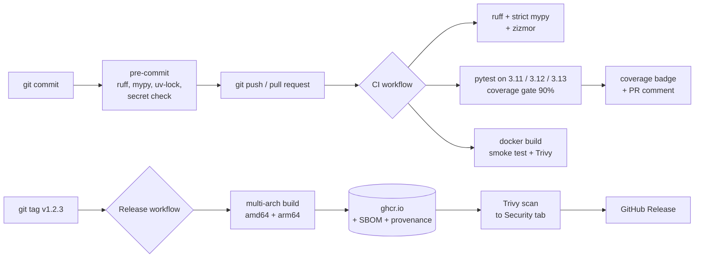

# ml-cicd-template

[](https://github.com/abhisheklakhani-it/ml-cicd-template/actions/workflows/ci.yml)
[](https://github.com/abhisheklakhani-it/ml-cicd-template/tree/python-coverage-comment-action-data)
[](https://github.com/abhisheklakhani-it/ml-cicd-template/actions/workflows/release.yml)
[](pyproject.toml)

A template repository for Python ML services. Click **Use this template**, replace the
model, and you get a tested FastAPI service plus a CI/CD pipeline that lints, type-checks,
tests, builds a Docker image, smoke-tests it, scans it for vulnerabilities and publishes it
to GitHub Container Registry on every version tag.

The model is deliberately small (logistic regression on scikit-learn's built-in wine
dataset), so the pipeline needs no downloads and stays fast. The point of the repo is the
delivery pipeline around the model, not the model.

## What the pipeline does



| Stage | Tool | Fails the build when |
|---|---|---|
| Lint and format | ruff (pyflakes, bugbear, bandit security rules, import order) | any rule is broken or a file is not formatted |
| Types | mypy `--strict` | a type does not match |
| Workflow security | zizmor | a workflow has a known GitHub Actions weakness |
| Tests | pytest on Python 3.11, 3.12, 3.13 | a test fails or coverage drops below 90% |
| Model quality | `--min-accuracy 0.9` in the Docker build, plus a test | the freshly trained model is worse than the bar |
| Container | Docker build + `curl` smoke test | the container does not start, answer correctly or run as non-root |
| Vulnerabilities | Trivy | a CRITICAL or HIGH vulnerability with an available fix is in the image |
| Release | buildx + GHCR | (on tag) publishes `:1.2.3`, `:1.2`, `:latest` with SBOM and provenance |

Dependabot opens weekly grouped pull requests for Python packages, GitHub Actions and the
Docker base image; CI tests each one before you merge it.

## Measured results

Measured on 24 Oct 2026 (local: Apple M2, Docker Desktop; CI: GitHub-hosted `ubuntu-latest`).

| | Result |
|---|---|
| Tests | 14, 100% line and branch coverage |
| Docker image | 136 MB (compressed), runs as user `app`, healthcheck `healthy` |
| Trivy, CRITICAL/HIGH with a fix | 0 (Debian 13 base and Python packages) |
| zizmor (pedantic) | 0 findings |
| Model test accuracy | 1.00 on 45 held-out samples (the wine dataset is easy; see limitations) |

## Quick start

```bash
make install        # uv sync + install the git hooks
make check          # what CI runs: lint, mypy, tests with coverage
make serve          # train, then run the API on http://127.0.0.1:8000 (docs at /docs)

make docker-build && make docker-run
curl -X POST localhost:8000/predict -H 'content-type: application/json' \
  -d '{"rows":[[13.2,1.78,2.14,11.2,100,2.65,2.76,0.26,1.28,4.38,1.05,3.4,1050]]}'
```

Or pull a released image:

```bash
docker run --rm -p 8000:8000 ghcr.io/abhisheklakhani-it/ml-cicd-template:latest
```

## API

| Method | Path | What it returns |
|---|---|---|
| GET | `/health` | `{"status": "ok", "version": ...}`; used by the Docker healthcheck |
| GET | `/model-info` | feature names (in order), class names, test metrics |
| POST | `/predict` | label, confidence and all class probabilities for 1–256 rows |

Wrong feature counts, empty or oversized batches and non-numbers get a `422` with a clear
message.

## Using it for your own model

1. Click **Use this template** on GitHub.
2. In `src/ml_service/model.py`, replace `load_data` and `build_pipeline`. Keep `ModelBundle`,
   so the API and tests keep working.
3. Adjust the quality bar (`--min-accuracy` in the `Dockerfile` and `test_quality_gate`).
4. Push. To release, `git tag v0.1.0 && git push --tags`.

If your model is large or trained elsewhere, download it in the builder stage instead of
training there; the runtime stage stays the same.

## Project layout

```
src/ml_service/
  model.py      train / save / load; ModelBundle wraps the pipeline and its metadata
  train.py      CLI: python -m ml_service.train --out models/model.joblib --min-accuracy 0.9
  app.py        FastAPI app: /health, /model-info, /predict
tests/          model, CLI and API tests (no network needed)
Dockerfile      builder (uv, train) -> runtime (venv + model only, non-root)
.github/
  workflows/ci.yml        lint, types, zizmor, test matrix, coverage, docker + Trivy
  workflows/release.yml   on tag: multi-arch push to GHCR, SBOM, provenance, scan, release
  dependabot.yml
.pre-commit-config.yaml   ruff, mypy, uv-lock, whitespace, YAML/TOML, private keys
Makefile                  install, check, serve, docker-build, docker-run
```

## Design decisions

- **uv instead of pip:** one lockfile (`uv.lock`) pins every package, so local, CI and
  Docker install exactly the same versions, and installs take seconds.
- **The model is trained inside the Docker build.** The image always contains a model that
  matches its code, and a model below the accuracy bar stops the build.
- **Multi-stage build:** uv, the build cache and the source tree stay in the builder stage.
  The runtime stage only gets the virtual environment and the model file.
- **Actions pinned to commit SHAs**, not tags: a tag can be moved to malicious code, a SHA
  cannot. Dependabot keeps the SHAs current.
- **Least-privilege tokens:** `permissions: {}` at the top of each workflow; each job asks
  only for what it needs.
- **The CLI is its own module (`train.py`).** Running `model.py` directly with `python -m`
  makes pickle record the class as `__main__.ModelBundle`, which the API cannot load.
  Running the real container caught this; `test_model_from_cli_loads_in_another_process`
  now guards it.

## Limitations

- The wine dataset is tiny (178 samples) and easy, so 1.00 test accuracy says nothing about
  real models. It is a placeholder that keeps the pipeline fast.
- Models are saved with joblib (pickle). Only load files you built yourself; for models from
  other people, use a safe format such as skops or ONNX.
- The Trivy gate ignores vulnerabilities that have no fix yet, so they are reported but do
  not fail the build.
- No deployment step: the pipeline ends at a published image. Deploying it (Kubernetes,
  Azure Container Apps) is a separate project.
- The coverage comment is only posted on pull requests from branches of this repository,
  not from forks, because forked runs get a read-only token.
